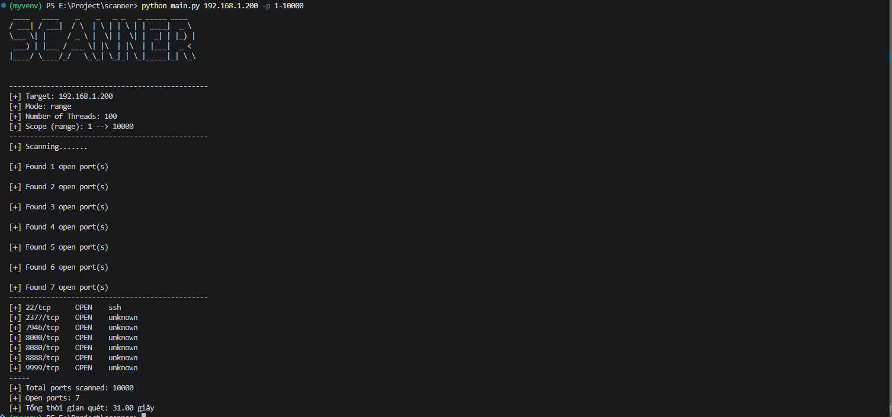

# Scanner Tool — Python TCP Port Scanner

> A lightweight, multithreaded TCP port scanner written from scratch in Python — built as a learning project to understand socket programming, host discovery, and concurrent scanning.


---

## About

This is a **from-scratch TCP port scanner** developed to explore how network reconnaissance works under the hood — without relying on Nmap or external scanning libraries.

The goal is not to replace mature tools, but to **understand the mechanics**: how TCP connections are established, how hosts are discovered when ICMP is filtered, and how concurrency can speed up port enumeration.

**What I learned building this**
- TCP socket programming with `socket`
- Multithreaded scanning with `ThreadPoolExecutor`
- ICMP ping vs. TCP-based host discovery (and why ping alone is unreliable)
- CLI design with `argparse` and input validation
- Modular project structure and iterative development via a written roadmap

---

## Features

| Feature | Description |
|---|---|
| **Host discovery** | ICMP ping check with OS-aware parameters (Windows / Linux) |
| **TCP fallback discovery** | If ping fails, scans a short list of common ports before concluding the host is down — handles firewalled hosts that block ICMP |
| **Multithreaded port scan** | Concurrent scans via `ThreadPoolExecutor`, configurable worker count |
| **Common port scan** | Fast scan of a curated list of frequently exposed ports (`--common`) |
| **Custom port range** | Scan a single port or a range (`-p 1-1000`) |
| **Service identification** | Resolves service names via `socket.getservbyport()` |
| **Verbose mode** | Live progress with percentage and scanned count (`-v`) |
| **Graceful shutdown** | Handles `KeyboardInterrupt` cleanly |

---

## Project Structure

```text
scanner-tool/
├── main.py                    # CLI entry point, argument parsing, orchestration
├── config.py                  # COMMON_PORTS, DEFAULT_MAX_WORKER
├── scanner/
│   ├── host_check.py          # ICMP ping + TCP fallback host discovery
│   ├── port_scan.py           # Multithreaded scan logic and result display
│   └── target.py              # IP validation, domain resolution, port parsing
├── checklist/                 # Development roadmap (basic & v2 intermediate)
├── tests/                     # Unit tests (in progress)
└── README.md
```

Each module has a single responsibility: input handling (`target.py`), host discovery (`host_check.py`), scanning (`port_scan.py`), and orchestration (`main.py`). This keeps the codebase easy to reason about and extend.

---

## 🚀 Installation & Usage

### Requirements

- Python 3.8+
- [`pyfiglet`](https://pypi.org/project/pyfiglet/) for the CLI banner

### Install

```bash
git clone https://github.com/ngngocatr/scanner-tool.git
cd scanner-tool
pip install pyfiglet
```

### Basic usage

```bash
python main.py <host> [options]
```

### Options

| Flag | Description |
|---|---|
| `host` | Target IP address or domain name (required) |
| `-l`, `--live-host` | Check whether the host is alive before scanning |
| `-p`, `--port` | Scan a single port or a range (e.g. `80` or `1-1000`) |
| `--common` | Scan a predefined list of common ports |
| `--threads` | Number of concurrent workers (default: 100) |
| `-v`, `--verbose` | Show live scan progress |

### Examples

**Check if a host is alive (with TCP fallback):**
```bash
python main.py 192.168.1.10 --live-host
```

**Scan a port range:**
```bash
python main.py 192.168.1.10 -p 1-1000
```

**Scan common ports with verbose progress:**
```bash
python main.py example.com --common -v
```

**Scan a single port with custom thread count:**
```bash
python main.py 10.0.0.5 -p 443 --threads 50
```

### Sample output



---

## 🧠 Design Notes

**Why ICMP ping alone is unreliable**
Many hosts and networks block ICMP echo requests while still exposing TCP services. Concluding "host is down" from a failed ping leads to false negatives. This tool falls back to scanning a short list of common ports before making that call — a pattern used in real reconnaissance workflows.

**Why `ThreadPoolExecutor` instead of raw threads**
`ThreadPoolExecutor` bounds the number of concurrent workers, prevents thread explosion, and simplifies result collection via `as_completed`. It also makes the worker count configurable without changing the code structure.

**Why split into modules**
A single-file scanner becomes hard to test and extend. Separating validation, discovery, and scanning allows each part to evolve independently — for example, adding banner grabbing later only touches `port_scan.py`.

---

## ⚖️ Disclaimer

This tool is intended for **educational purposes and authorized testing only**. Only scan systems you own or have **explicit written permission** to test. Unauthorized scanning may violate laws and network policies. The author assumes no liability for misuse.

---

## 📬 Contact

- **GitHub:** [@ngngocatr](https://github.com/ngngocatr)

---

## 📄 License

Released under the [MIT License](./LICENSE).